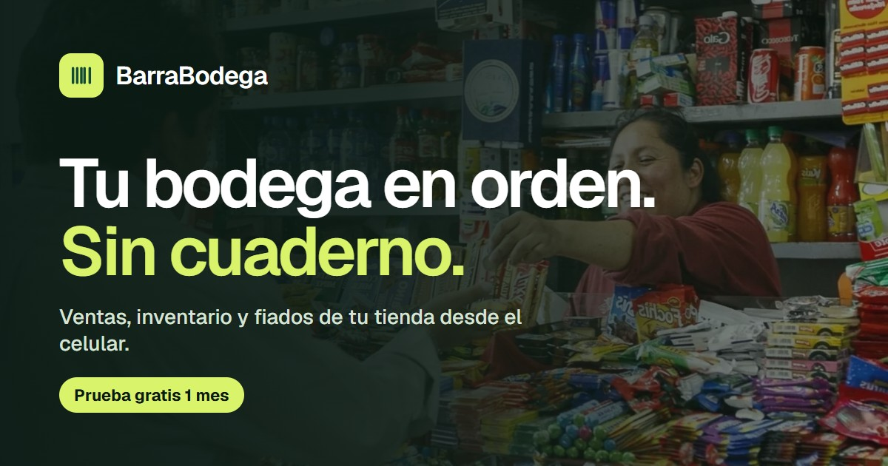

# BarraBodega · Landing page

Landing de **BarraBodega**, la app para tiendas de barrio en Perú: escanea productos con la cámara del celular, registra ventas, controla fiados y muestra cuánto se vendió en el día. La página presenta el producto y lleva al visitante a pedir su mes de prueba gratis por WhatsApp.

**Sitio:** https://barrabodega.lat

## Stack

- **Astro 7**: sitio estático, sin JavaScript salvo el de las secciones interactivas
- **Tailwind CSS 4**: tema propio (colores, tipografía, animaciones) en `src/styles/global.css`
- **Motion**: animaciones de entrada, parallax y efectos ligados al scroll; respeta `prefers-reduced-motion`
- **SEO**: meta tags, Open Graph, JSON-LD (Organization, SoftwareApplication, VideoObject, FAQPage), sitemap y robots.txt

## Cómo editar

- **Textos, precios y preguntas:** `src/data/landing.ts`
- **Número de WhatsApp, título y descripción para Google:** `src/config/site.ts`
- **Imágenes:** reemplaza el archivo en `src/assets/images/` con el mismo nombre
- **Imagen para compartir en redes:** `public/og-image.jpg` (1200×630)

## Comandos

| Comando        | Acción                                 |
| :------------- | :------------------------------------- |
| `pnpm install` | Instala las dependencias               |
| `pnpm dev`     | Servidor de desarrollo en `localhost:4321` |
| `pnpm build`   | Genera el sitio en `./dist/`           |
| `pnpm preview` | Previsualiza el build                  |

---

Desarrollado por [juanra software](https://juanrasoftware.lat).
